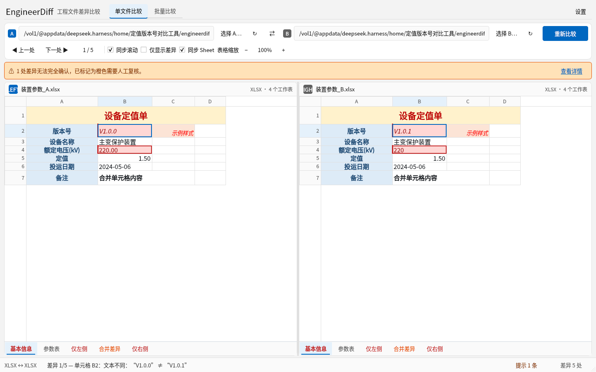
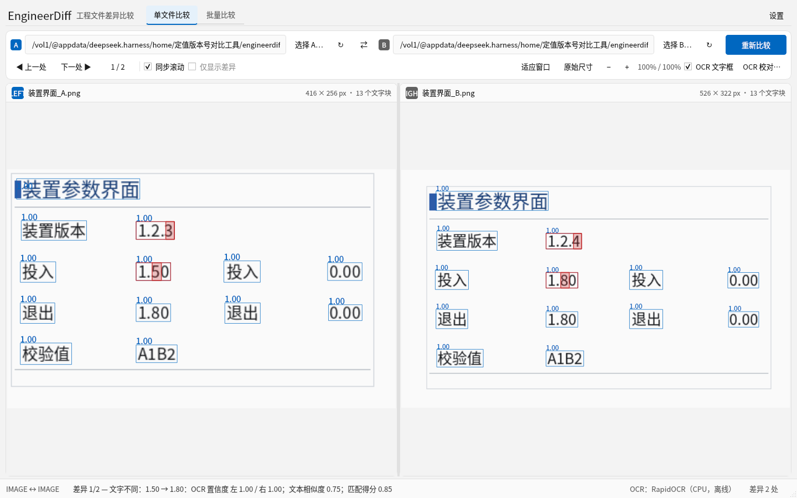
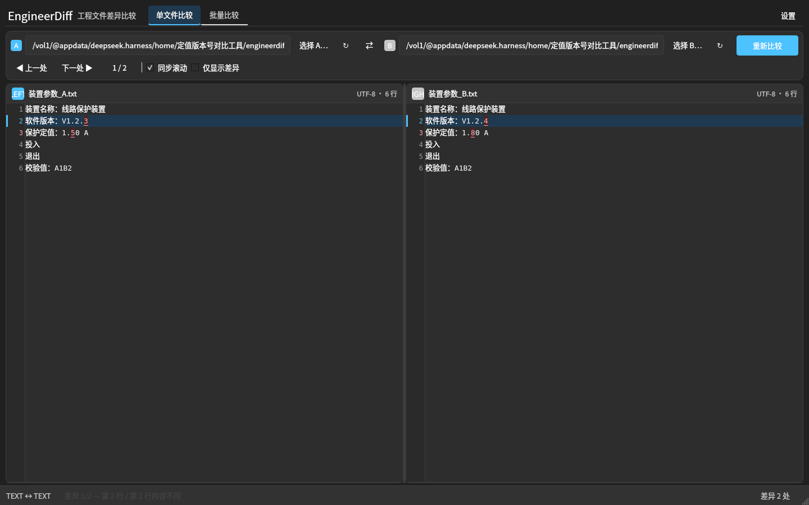
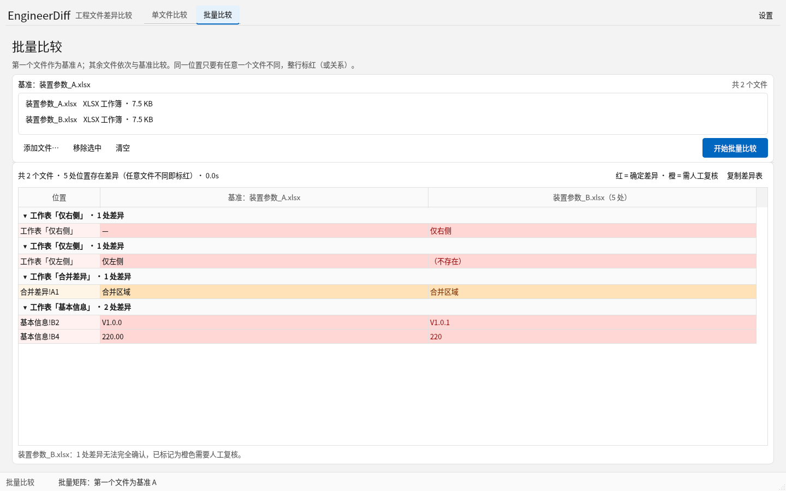
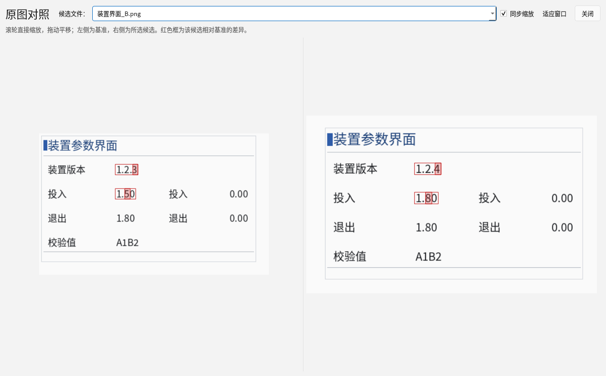

# EngineerDiff

**Windows 本地多格式文件差异比较工具 · 工程现场核对专用**

EngineerDiff 用于核对两版装置软件版本信息、保护定值表、参数配置文件、TXT/CSV 资料、
Excel 工作簿和装置界面截图。它把差异**直接标在原始内容上**：文本标字符、Excel 标单元格与
Sheet 标签、截图标在原文字位置，不需要阅读额外的差异报告。

所有比较完全在本机完成；OCR 引擎与模型随安装包内置，**无需联网、无需安装 Python / Office /
Paddle / ONNX Runtime**。


## 功能一览

| 格式 | 比较方式 | 差异呈现 |
|---|---|---|
| TXT | 行级对齐 + 行内字符级比较，编码识别（UTF-8/GBK/UTF-16 等） | 字符级红色背景/红色文字；新增/删除整行高亮 |
| CSV | 原始文本视图 + 表格视图（标准 CSV 引号/逗号/跨行字段解析） | 字符级或单元格级标红 |
| XLS / XLSX | 按 **Sheet 名称**配对，严格坐标单元格比较；公式/缓存值可选；合并单元格 | 单元格红/橙标红，Sheet 标签标红，左右 Sheet 联动 |
| PNG / JPG / JPEG / BMP | **内置 RapidOCR + ONNX Runtime**，跨分辨率/位置/缩放匹配文字 | 在原截图对应文字/字符位置叠加半透明红/橙框 |

- **Fluent 2 / Windows 11 原生视觉**：顶部“单文件比较 / 批量比较”标签导航、Segoe UI Variable、
  统一 4/8px 间距与分层圆角、克制的表面层次；设置中可切换**浅色 / 深色 / 跟随系统**；
- **拖入文件即自动加载并比较**；图片拖入先显示原图，再在后台 OCR；结果页仍可继续拖入新文件替换；
- 统一差异导航：上一处 / 下一处、当前序号 / 总数、自动定位两侧、同步滚动；
- 红色 = 确认差异，橙色 = OCR 低置信度/无法可靠配对，需人工复核；
- 图片支持鼠标滚轮直接缩放、Shift+滚轮横向平移、拖动查看、Ctrl+V 粘贴截图；
- Excel 多 Sheet、顺序无关配对、缺失 Sheet 占位、标签差异标红、同步 Sheet 开关、表格缩放；
- OCR 校对：查看识别框与置信度、修改识别文本、手动建立左右文字对应后重新比较；
- **批量比较页**：顶部导航直接切换，一个基准 + 多个候选，生成“任意文件不同即标红”的差异矩阵；
  Excel 按 Sheet 分组并支持折叠，图片可打开“原图对照”查看基准与候选；
- **OCR 加速**：首次拖入图片后台预识别、相同图片跳过 OCR、跨次 OCR 缓存、模型进程内共享；
- 纯离线，无登录、无云服务、无文件上传。

## 截图

| Excel 多 Sheet | 图片 OCR |
|---|---|
|  |  |

| 深色主题 | CSV 表格 |
|---|---|
|  |  |

| 批量比较（Excel Sheet 分组） | 图片批量原图对照 |
|---|---|
|  |  |

## 系统要求

- Windows 10 / 11 x64；默认按当前用户安装，无需管理员权限；
- 4 GB 内存以上；安装约 450 MB（含 Qt、ONNX Runtime 与 OCR 模型）；
- 无需 Microsoft Office、Python、VC++ 运行库（VC++ 运行库随包）；无需网络。

## 安装与使用

1. 从 [GitHub Releases](https://github.com/youyoudezhuzhu/engineerdiff/releases/latest) 下载并运行
   `EngineerDiff-1.1.0-Setup-x64.exe`（或解压便携版 zip，保持 `_internal` 目录完整）；
2. 选择或拖入左右文件；**拖入后自动比较**（图片先显示原图，再 OCR），截图可 Ctrl+V 粘贴；
3. 用“上一处/下一处”或 F7/F8 查看差异；需要时点击“重新比较”；
   点击顶部 **“批量比较”** 标签可选择一个基准 + 多个候选文件，一次查看所有差异；
4. 详细说明见 [简体中文使用说明](docs/user-guide.md)，限制见 [已知限制](docs/known-limitations.md)；
5. 未签名安装包可能触发 SmartScreen/Defender；**Windows 11 智能应用控制会直接拦截未签名应用且没有单应用白名单**，
   原因与签名方案见 [代码签名 / 智能应用控制说明](docs/code-signing.md)，Defender 误报见
   [Defender 误报说明](docs/windows-defender.md)。

示例文件在 [`samples/`](samples/)：TXT、CSV、多 Sheet XLSX、不同尺寸的中文装置截图。

## 为什么是这套技术栈

正式开发前实际调查了 WinMerge、open-diff、hotdiff、xlsx-compare、xlsxDiff、sheet-diff、
RapidOCR、PaddleOCR 等项目的源码、许可证与维护状态，结论：

- **不 fork WinMerge / hotdiff / open-diff 作为主体**：它们分别是 C++/MFC（GPL-2.0）、
  Go/Wails、Rust/Tauri，无法同时满足“Python 桌面程序 + Excel 单元格标红 + 内置离线 OCR +
  MIT 分发”；
- **文本**：Python 标准库 `difflib` 自研行/字符级算法，精确控制字符 span；
- **Excel**：openpyxl（XLSX，双载公式与缓存值）+ xlrd（XLS）；自绘虚拟化表格；
- **OCR**：RapidOCR（Apache-2.0）+ ONNX Runtime（CPU），模型随 wheel 分发并打包进安装包；
- **图片匹配**：OpenCV ORB/文本锚点估计几何变换 + 文本相似度 + 邻域/行列上下文 + 一对一分配；
- **打包**：PyInstaller onedir + Inno Setup 6（per-user 安装、中文、完全离线）。

完整的证据、许可证矩阵与风险分析见 [技术选型报告](docs/technical-selection.md) 与
[调查记录](docs/research-notes.md)。

## 架构

```
Application (app.py)
  └─ UI (PySide6): MainWindow / TextView / GridView / ImagePane / OcrCorrectionDialog
       └─ 后台 QThread Worker（比较、OCR，不阻塞界面）
  └─ compare.py 编排
       ├─ FileLoader：格式识别、兼容性判定
       ├─ TextDiff：编码识别、行对齐、字符级 span
       ├─ Spreadsheet：XLSX/XLS 读取、Sheet 配对、单元格比较、CSV 解析
       ├─ OCR：RapidOCR + ONNX Runtime，坐标/置信度/缓存/取消
       └─ ImageMatcher：几何变换 + 文本匹配 + 字符框估算
  └─ DiffModel：统一 DiffItem/DiffLocation（文本/表格/图片共用）
  └─ Renderer：各视图按统一模型标红
Packaging：PyInstaller onedir + Inno Setup + GitHub Actions Windows CI
```

比较引擎不依赖 Qt，可单独测试；UI 只消费统一差异模型。详见
[架构说明](docs/architecture.md)。

## 开发与测试

```bash
# Python 3.11
python -m venv .venv
.venv/Scripts/pip install -r requirements-dev.txt      # Windows
.venv/bin/pip install -r requirements-dev.txt          # Linux/macOS 开发
.venv/bin/pip install -e . --no-deps

QT_QPA_PLATFORM=offscreen .venv/bin/python -m pytest -q
.venv/bin/python -m engineerdiff --self-test            # 7 项端到端自检
```

测试覆盖文本字符差异、编码、忽略规则、CSV 引号/跨行、XLSX/XLS 多 Sheet/公式/合并单元格、
智能行对齐、OCR 真实推理、跨分辨率图片匹配、图片覆盖框位置、统一差异导航、Sheet 联动等。
截图回归产物位于 `tests/fixtures/generated/`（不提交）。

## Windows 构建与安装包

推荐直接用 GitHub Actions（`.github/workflows/build-windows.yml`）：

1. 运行 **Windows Build & Release**（push `main` 或手动 `workflow_dispatch`）；
2. 流程：依赖断言 → 全量 pytest（含 OCR）→ PyInstaller onedir → 打包后 `--self-test` →
   Inno Setup → **静默安装 → 安装后 `--self-test` → 静默卸载** → artifact；
3. 推送 `v1.1.0` tag 自动发布 GitHub Release（安装包、便携 zip、SHA-256）。

本地 Windows 构建（需要 Python 3.11、Inno Setup 6）：

```powershell
powershell -ExecutionPolicy Bypass -File scripts\build_windows.ps1
# 产物：release\EngineerDiff-1.1.0-Setup-x64.exe
#       release\EngineerDiff-1.1.0-portable-win64.zip
#       release\sha256sums.txt
```

## 隐私与离线

- 程序不包含任何联网代码，不上传文件、不做版本检查、不需要账号；
- OCR 模型位于安装目录 `_internal` 内，首次识别只做本地模型加载；
- 用户 OCR 缓存位于 `%LOCALAPPDATA%\EngineerDiff`，可在设置中清除；卸载默认保留。

## 许可证

本项目代码采用 [MIT License](LICENSE)。随包分发的 Qt/PySide6、RapidOCR、ONNX Runtime、
OpenCV、openpyxl、xlrd、Pillow、numpy、charset-normalizer、OCR 模型等第三方组件遵循各自
许可证；详见 [第三方许可证](docs/third-party-licenses.md) 与安装包内 `LICENSES/`。
PySide6 以 LGPL-3.0 动态链接方式使用，安装包为 onedir 结构，保留 Qt DLL 可替换性。
