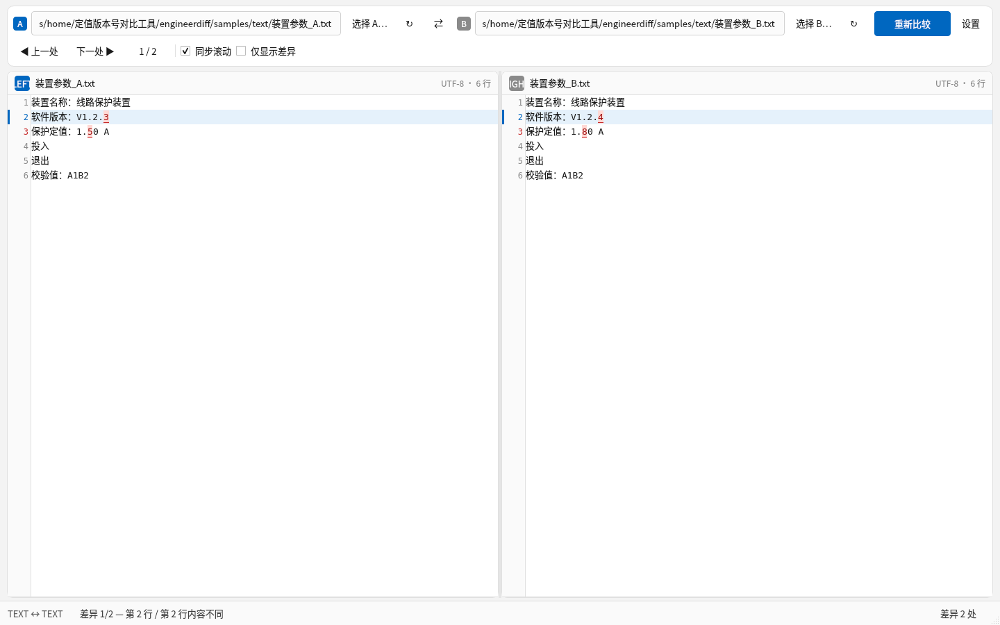
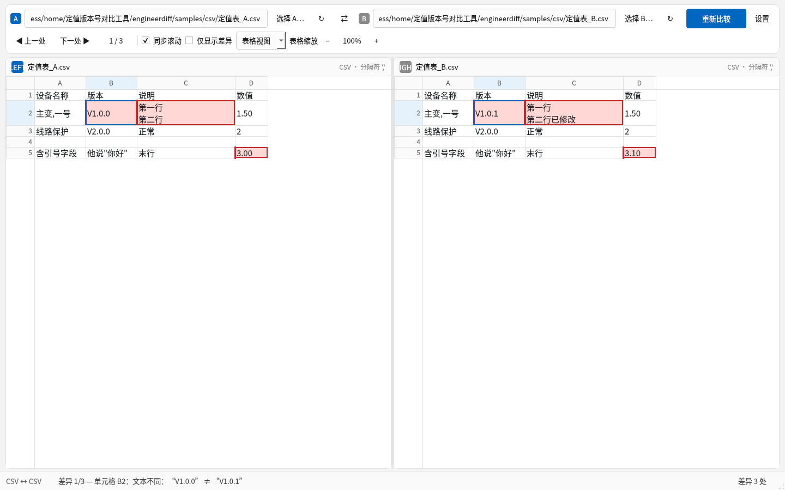
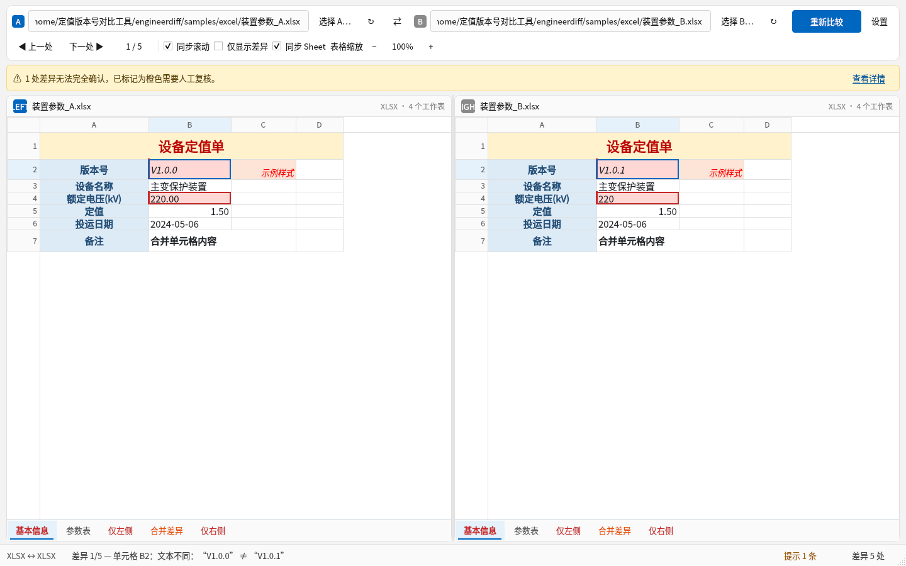
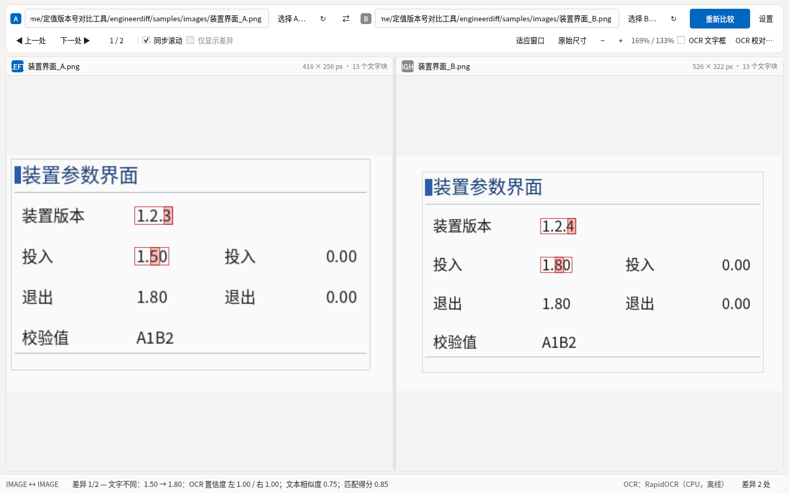

# EngineerDiff 使用说明（Windows）

EngineerDiff 是一个 **Windows 本地、完全离线** 的工程文件差异比较工具，用于快速找出两版
定值单/装置配置文件之间的差异。支持：

- **文本**：`.txt`
- **表格**：`.csv`、`.xls`、`.xlsx`（Excel 按工作表名称配对，可跨 Sheet 比较）
- **图片/截图**：`.png`、`.jpg`、`.jpeg`、`.bmp`（内置 OCR，自动识别截图中的文字并标出差异）

所有比较都在本机完成：不联网、不上传文件、不依赖 Office 或外部 Python 环境。
差异分为 **红色（确认差异）** 与 **橙色（无法可靠确认，需人工复核）** 两种。

---

## 1. 系统要求

| 项目 | 要求 |
|---|---|
| 操作系统 | Windows 10 / Windows 11，64 位（x64） |
| 磁盘空间 | 安装后约 400–500 MB（含离线 OCR 模型与 Qt 运行库） |
| 内存 | 建议 4 GB 以上；超大 Excel / 高分辨率截图需要更多 |
| 网络 | **不需要**。程序不包含任何联网功能 |
| 其他 | 无需管理员权限（默认按当前用户安装）；无需安装 Office、Python、Paddle、VC++ 运行库（已随包附带） |

---

## 2. 安装与卸载

### 2.1 安装包安装（推荐）

1. 运行 `EngineerDiff-1.0.0-Setup-x64.exe`。
2. 按向导完成安装。默认 **仅为当前用户安装**，安装目录为：

   ```text
   %LOCALAPPDATA%\Programs\EngineerDiff
   ```

   无需管理员权限；不会写入系统目录、不会安装系统服务。
3. 安装完成后可在 **开始菜单** 找到 `EngineerDiff`；如需桌面快捷方式，请在安装向导中
   勾选“创建桌面快捷方式”（默认不勾选）。
4. 安装程序包含简体中文界面、MIT 许可页、卸载程序，以及随包的使用说明、已知限制和
   第三方许可证（安装目录下 `docs\`、`LICENSES\`、`THIRD-PARTY-NOTICES.md`）。

> 注意：安装包未做代码签名，首次运行时 Windows SmartScreen 可能提示“未知发布者”。
> 请核对 `sha256sums.txt` 中的 SHA-256 后再选择“仍要运行”。校验方法（PowerShell）：
>
> ```powershell
> Get-FileHash .\EngineerDiff-1.0.0-Setup-x64.exe -Algorithm SHA256
> ```

**静默安装**（批处理/内网分发，Inno Setup 标准参数）：

```bat
EngineerDiff-1.0.0-Setup-x64.exe /VERYSILENT /SUPPRESSMSGBOXES /NORESTART
```

需要为所有用户安装时，可由管理员执行 `/ALLUSERS`（此模式会写入
`%ProgramFiles%\EngineerDiff`，并需要管理员权限）。

### 2.2 卸载

任选其一：

- **设置 → 应用 → 已安装的应用 → EngineerDiff → 卸载**；
- 开始菜单 → `EngineerDiff` 文件夹 → “卸载 EngineerDiff”；
- 控制面板 → 程序和功能。

卸载会删除程序文件、快捷方式和注册表项。**用户 OCR 缓存与比较设置默认保留**；
如需彻底清理，请手动删除：

```text
%LOCALAPPDATA%\EngineerDiff
```

### 2.3 便携版（免安装）

将 `EngineerDiff-1.0.0-portable-win64.zip` 解压到任意可写目录后，直接运行
`EngineerDiff.exe`。**必须保留解压后的完整目录结构**（`EngineerDiff.exe` 与
`_internal\` 目录不可分开移动/删除，OCR 模型与 Qt 插件都在其中）。

---

## 3. 快速上手

1. 启动 EngineerDiff。
2. 在顶部选择左右两个文件：
   - 点击 **“选择 A…”** 选择基准文件（旧版/参考版）；
   - 点击 **“选择 B…”** 选择待比较文件（新版）；
   - 也可以把文件直接**拖到**对应一侧的窗口区域；
   - 或复制文件/截图后按 **Ctrl+V** 粘贴到当前焦点一侧（支持剪贴板图片）。
3. 点击 **“开始比较”**（或按 **Ctrl+Enter**）。
4. 比较完成后，状态栏显示差异数量与耗时；使用 **F7 / F8**（或工具栏“上一处/下一处”）
   在差异之间跳转，当前差异会自动滚动/缩放到可见位置。
5. 需要改比较规则时点击 **“设置”**（详见第 8 节），保存后点击“重新比较”生效。

两侧文件类型必须匹配：文本 ↔ 文本、CSV ↔ CSV、Excel ↔ Excel、图片 ↔ 图片；
类型不兼容时程序会给出中文提示，不会强行比较。

### 界面预览

| 文本比较 | CSV 表格比较 |
|---|---|
|  |  |

| Excel 多工作表比较 | 图片 OCR 比较 |
|---|---|
|  |  |

更多截图见 `docs/screenshots/`（安装后在安装目录 `docs\screenshots\`）。

---

## 4. 文本比较（TXT）

- 支持 `.txt`；自动识别编码：BOM（UTF-8/UTF-16/UTF-32）、UTF-8、GB18030/GBK，
  最后用 charset-normalizer 兜底。编码识别结果与行数显示在左右两侧标题栏。
- 逐行并排显示，行号固定；行的新增/删除用占位行对齐。
- 差异既支持**整行标红**，也支持**字符级标红**（例如 `V1.2.3` 与 `V1.2.4`
  只标出不同的那一个字符），中文与中英混排均适用。
- 默认**严格比较**：换行符（CRLF/LF）、行尾空格、大小写等真实差异都会标出；
  需要的场景可在“设置 → 文本比较”中忽略对应项（默认全部不忽略）。
- 两侧滚动默认同步（可关闭“同步滚动”）；用“上一处/下一处”或 F7/F8 导航时，差异会在对应视图内定位。

---

## 5. CSV 比较

- 使用标准 CSV 解析：支持引号包裹的逗号、字段内换行、双引号转义；
  自动识别分隔符（`,`、`;`、Tab、`|`）。
- CSV 有 **两种视图**，用工具栏下拉框切换：
  - **表格视图**：按单元格并排比较，差异单元格浅红/橙高亮；
  - **文本视图**：按原始文本逐行比较，适合仅关注文本改动。
- CSV 字段按**原始文本**比较，不做隐式数值化——因此 `001` 与 `1`、`1.50` 与 `1.5`
  在 CSV 中会被视为不同（Excel 中数值单元格才会按数值规则比较）。
- 编码自动识别（UTF-8/GBK 等）；左右分隔符不同时会给出提示，表格列可能无法逐列对应，
  建议先统一格式。
- CSV 没有工作表概念，标签栏不显示。

---

## 6. Excel 比较（XLS / XLSX）

### 6.1 工作表配对

- 按**工作表名称**精确配对，与工作簿内的先后顺序无关。顺序不同但内容相同 → 不标红。
- 仅在一侧存在的工作表：标签栏对应工作表名标红，并生成一条“仅左侧/仅右侧”差异。
- 底部标签栏显示所有工作表；有差异的工作表名标红。点击标签切换工作表，开启同步时
  左右两侧同时切换；某一侧没有同名工作表时，该侧显示“无对应工作表”占位，不会错位到
  别的工作表。工具栏的 **“同步 Sheet”** 可单独关闭工作表联动（不影响滚动同步）。
- 表格视图支持 **“表格缩放” − / 百分比 / +**（50%–250%），两侧同步缩放；单元格与合并
  单元格按缩放比例重绘，表头保持固定大小。

### 6.2 单元格比较规则

- **严格按坐标比较**（同一行列位置），不做智能行对齐（默认）。
- 空白 vs 非空、文本 vs 数值、布尔、日期、错误值等类型差异都会标出。
- 数值按精确值比较（`1.50` 与 `1.5` 视为相同），默认容差为 0；可在设置中设置数值容差。
- 日期按规范化日期值比较；字符串严格区分大小写与空白。
- 合并单元格区域不一致时，在合并区域左上角单元格生成一条**橙色**提示，供人工复核。
- 公式比较策略（设置 → 表格/Excel 比较）：
  - **按公式表达式比较（默认，严格）**：两侧公式文本不同即判定差异；
  - **按缓存计算结果比较**：比较保存的计算结果；缓存缺失会以橙色提示，需人工复核。
- **XLS（旧格式）限制**：xls 文件不保存公式表达式（xlrd 也无法读取），只能按缓存值
  比较，程序会显示提示；请以打开文件后的实际值为准。

### 6.3 大表格与视图

- 表格视图为自绘虚拟化渲染：只绘制屏幕内单元格，万行级表格也能流畅滚动。
- “仅显示差异”只保留差异行及其上下文，行号仍显示原始行号。
- 列宽、行高、合并单元格、基本字体/对齐/填充色按原表还原；比较不比较样式。

---

## 7. 图片 / 截图 OCR 比较

适用于装置面板截图、保护定值界面截图、软件版本界面截图等。支持不同分辨率、不同窗口
位置、不同缩放的左右截图。

### 7.1 颜色含义

- **红色**：确认差异（OCR 文本不同，或仅一侧存在文字）。
- **橙色**：无法可靠确认（OCR 置信度低、文字对应关系有歧义），需人工复核。
- 覆盖框绘制在原图上，不修改原文件；相同文字不会叠加高亮。

### 7.2 操作

- **适应窗口 / 原始尺寸 / + / −**：缩放两侧图片；也可用 **Ctrl+滚轮** 缩放、拖动平移。
- “同步滚动 / 同步缩放”开启时（默认），两侧图片一起缩放、滚动，便于对照同一区域。
- **“OCR 文字框”**：显示全部 OCR 文字框与置信度，便于核对 OCR 是否识别正确。
- **OCR 校对…**：打开校对对话框，可以：
  - 查看左右两侧 OCR 文本、置信度与坐标；
  - 直接修改识别错的文字；
  - 手动建立/解除左右文字的对应关系（解决重复字段如“投入/退出/0.00”的配对歧义）；
  - 应用后按修正结果重新比较。**校对只影响当前比较，不会修改原图片文件。**

### 7.3 OCR 说明

- OCR 引擎为 **RapidOCR + ONNX Runtime**，CPU 推理，模型随安装包分发，**完全离线**。
- 首次对某张图片做 OCR 时会加载模型、耗时较长（通常数秒）；之后相同图片命中本地缓存，
  明显加快。缓存按图片内容 SHA-256 保存，可在“设置 → 图片 OCR 比较 → 清除 OCR 缓存”
  中清理。
- 识别结果保留原图坐标，因此红/橙框位置与截图文字对齐；匹配算法会综合文本相似度、
  几何位置、相邻文字与行列结构，而不是简单按顺序配对。

---

## 8. 设置

点击顶部 **“设置”**，更改后点击“确定”保存；设置在下一次比较（或点击“重新比较”）时生效。
设置按当前 Windows 用户保存在注册表 `HKEY_CURRENT_USER\Software\EngineerDiff\EngineerDiff`。

| 分组 | 选项 | 说明 | 默认 |
|---|---|---|---|
| 文本比较 | 忽略换行符差异 | 忽略 CRLF/LF 与末尾换行差异 | 关 |
| 文本比较 | 忽略每行前后空格 | 忽略行首/行尾空白 | 关 |
| 文本比较 | 忽略全部空白字符 | 忽略行内所有空白 | 关 |
| 文本比较 | 忽略大小写 | `ABC` 与 `abc` 视为相同 | 关 |
| 表格/Excel | 公式比较 | 按公式表达式 / 按缓存计算结果 | 公式表达式 |
| 表格/Excel | 数值容差 | 两侧数值差在容差内视为相同；0 为严格 | 0 |
| 表格/Excel | 智能行对齐（实验性） | 尝试识别整行插入/删除；不改变严格坐标模式 | 关 |
| 图片 OCR | 人工复核阈值 | OCR 置信度低于该值标橙 | 0.60 |
| 图片 OCR | 比较后默认显示 OCR 文字框 | 默认打开文字框显示 | 关 |
| 图片 OCR | 清除 OCR 缓存 | 删除本地 OCR 缓存 | — |
| 通用 | 默认同步切换 Excel 工作表 | 左右工作表联动 | 开 |
| 通用 | 默认同步滚动 / 同步缩放 | 两侧滚动和图片缩放联动 | 开 |

设置对话框中的“恢复默认”可一键还原全部默认值。

---

## 9. 快捷键

| 快捷键 | 功能 |
|---|---|
| `Ctrl+O` | 选择基准文件 A |
| `Ctrl+Shift+O` | 选择待比较文件 B |
| `Ctrl+Enter` | 开始比较 / 重新比较 |
| `F7` | 上一处差异 |
| `F8` | 下一处差异 |
| `Ctrl+V` | 把剪贴板中的文件/截图粘贴到当前焦点一侧 |
| `Ctrl+滚轮` | 图片视图缩放（图片比较时） |

文件也可直接拖放到左侧或右侧区域。

---

## 10. 命令行参数

EngineerDiff 支持少量命令行参数（主要用于自动化与安装包自检）：

| 参数 | 说明 |
|---|---|
| `--version` | 打印版本号后退出 |
| `--self-test` | 运行内置自检（无需显示界面）：检查文本/CSV/Excel 比较、OCR 模型、图片比较流程、界面组件导入等 |
| `--self-test-report <path>` | 指定自检 JSON 报告输出路径（默认当前目录 `self-test-report.json`） |
| `--left <file>` | 启动时载入左侧文件 A |
| `--right <file>` | 启动时载入右侧文件 B |

自检报告格式：`{"ok": true|false, "version": "...", "checks": [...], "error": "..."}`。
`--self-test` 成功时退出码为 0，失败为非 0；安装包/CI 用它验证打包产物完整
（尤其是 OCR 模型是否随包）。

---

## 11. 故障排查

| 现象 | 处理 |
|---|---|
| 启动失败/闪退 | 查看用户主目录下的 `~/.engineerdiff-crash.log`（Windows 为 `C:\Users\<用户名>\.engineerdiff-crash.log`），其中包含错误堆栈 |
| SmartScreen 提示未知发布者 | 安装包未签名；请用随包 `sha256sums.txt` 校验后选择“仍要运行” |
| 提示缺少 DLL / 无法启动 | 确认是从安装包安装或完整解压便携版；`EngineerDiff.exe` 必须与 `_internal\` 目录保持相对位置。安装包已自带 VC++ 运行库（msvcp140/vcruntime140 等），若被安全软件隔离请恢复文件或重新安装 |
| 打开 Excel 很慢或提示截断 | 超大工作表会被限制行/列读取并给出提示；可先拆分工作簿 |
| XLS 公式没有按公式比较 | xls 不保存公式表达式，只能按缓存值比较（程序会提示），这是格式限制 |
| 文本乱码 | 程序会自动识别编码；如仍乱码，请用记事本/VSCode 将文件另存为 UTF-8 |
| OCR 很慢 | 首次使用需加载模型；之后相同图片命中缓存会明显加快；可关闭其他占用 CPU 的程序 |
| OCR 识别错误较多 | 使用“OCR 校对…”修正文字或手动配对；截图尽量清晰、避免过度压缩/缩放 |
| 图片差异框偏移 | 左右截图版面差异过大（如完全不同的窗口布局）时匹配可能不可靠，此时会以橙色提示人工复核 |
| 比较结果与预期不同 | 检查“设置”中的忽略项、公式策略、数值容差、智能行对齐是否开启 |
| 卸载后设置仍在 | 设置与 OCR 缓存在 `%LOCALAPPDATA%\EngineerDiff`，默认保留；可手动删除 |
| 杀毒软件误报 | 程序为 PyInstaller 打包的未签名 exe，可能被启发式误报；请添加信任或从 Release 重新下载并校验哈希 |

---

## 12. 文件与目录

| 内容 | 位置 |
|---|---|
| 程序文件 | `%LOCALAPPDATA%\Programs\EngineerDiff`（默认 per-user 安装） |
| 使用说明/已知限制/第三方许可证 | 安装目录 `docs\`、`LICENSES\`、`THIRD-PARTY-NOTICES.md`、`MODEL_LICENSES.md` |
| 比较设置 | 注册表 `HKCU\Software\EngineerDiff\EngineerDiff` |
| OCR 缓存 | `%LOCALAPPDATA%\EngineerDiff`（由程序自动创建，可清除） |
| 崩溃日志 | `%USERPROFILE%\.engineerdiff-crash.log` |
| 剪贴板临时截图 | 系统临时目录下的 `engineerdiff-paste-*`，程序退出时清理 |

---

## 13. 许可证

EngineerDiff 本体以 **MIT** 许可证发布（见安装目录 `LICENSE`）。随包第三方组件
（PySide6/Qt、RapidOCR、ONNX Runtime、OpenCV、Pillow、numpy、openpyxl、xlrd 等）的
许可证与合规说明见 `THIRD-PARTY-NOTICES.md`、`MODEL_LICENSES.md` 与 `docs/third-party-licenses.md`。
